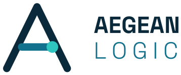
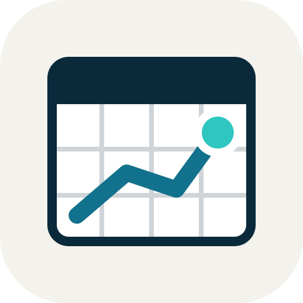
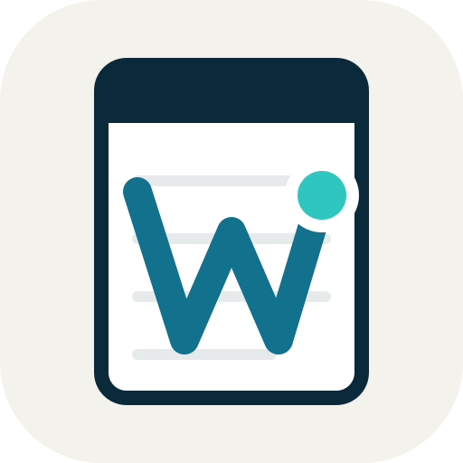
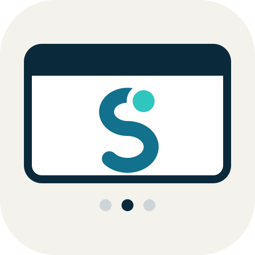
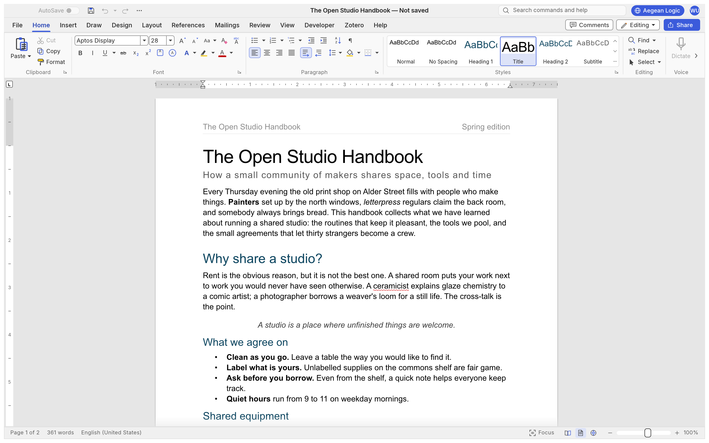
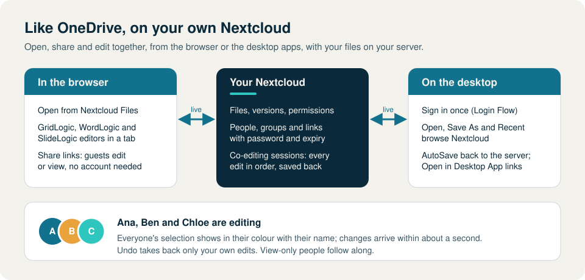
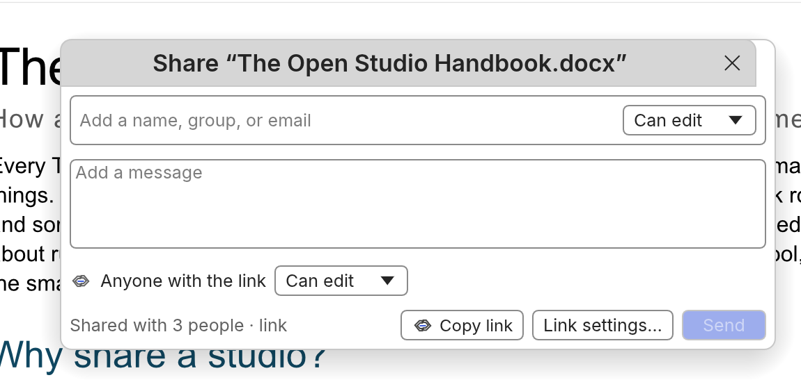
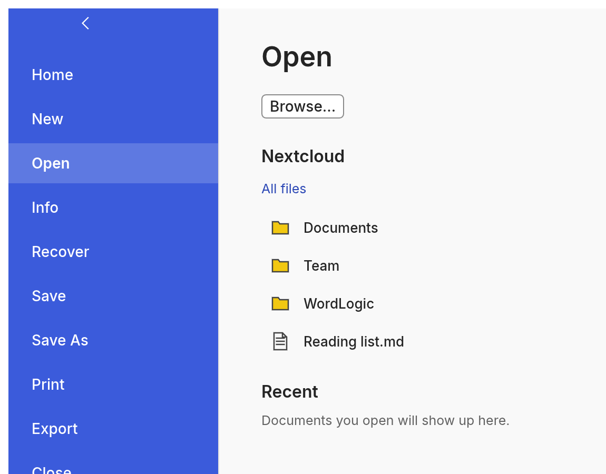
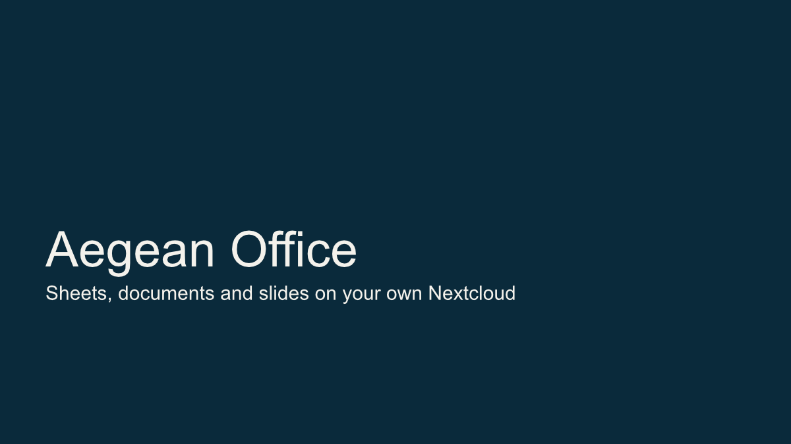
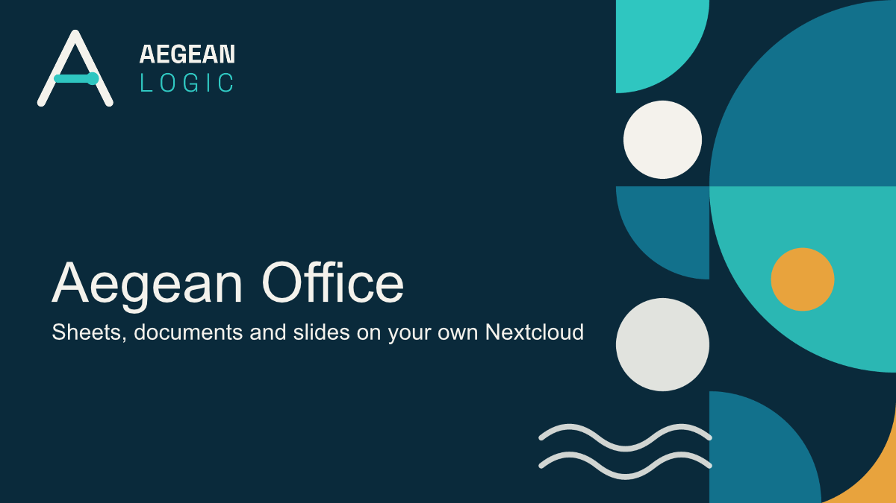

<p align="center">
  <picture>
    <source media="(prefers-color-scheme: dark)" srcset="brand/aegean-logic/aegean-logic-lockup-dark.svg">
    
  </picture>
</p>

<h1 align="center">Aegean Office</h1>

<p align="center">
  <b>Spreadsheets, documents and presentations: open source, Rust-native, and at home on your own Nextcloud.</b><br>
  Native on Windows, macOS and Linux, and in the browser.
</p>

<table align="center">
  <tr>
    <td align="center" width="260">
      <br>
      <b><a href="https://github.com/Aegean-Logic/gridlogic">GridLogic</a></b><br>
      Spreadsheets
    </td>
    <td align="center" width="260">
      <br>
      <b><a href="https://github.com/Aegean-Logic/wordlogic">WordLogic</a></b><br>
      Documents
    </td>
    <td align="center" width="260">
      <br>
      <b><a href="https://github.com/Aegean-Logic/slidelogic">SlideLogic</a></b><br>
      Presentations
    </td>
  </tr>
</table>

---

## The apps

### GridLogic: spreadsheets

Formulas, tables, pivots, charts and conditional formatting, with Excel `.xlsx` files read and
written as they are. Based on [GridCraft](https://github.com/storytold/gridcraft).

<p align="center"></p>

### WordLogic: documents

Styles, navigation, references, review and page layout, with Word `.docx` files, ODT, RTF and
Markdown. Based on [WordCraft](https://github.com/storytold/wordcraft).

<p align="center"></p>

### SlideLogic: presentations

Layouts, themes, shapes, charts, animations and presenting, with PowerPoint `.pptx` files.
Based on [DeckCraft](https://github.com/storytold/deckcraft).

<p align="center"></p>

---

## OneDrive-style sharing, on your own Nextcloud

Each app has a Nextcloud app beside it. Together they work the way Office does with OneDrive, but
the files stay on a server you run.

<p align="center"></p>

- **Open from Nextcloud Files.** Spreadsheets, documents and presentations open in their editor
  in the browser, straight from Files.
- **Share like Office.** The Share button opens one dialog in the browser and on the desktop:
  people and groups with edit or view rights, links with a password and an expiry date, and
  guests who need no account.
- **Edit together, live.** Everyone with the file open edits it at the same time. Each person's
  selection shows in their colour with their name, changes arrive within about a second, and
  Undo only takes back your own edits.
- **Desktop apps sign in too.** File › Account signs in once with Nextcloud's Login Flow. Open,
  Save As and Recent browse Nextcloud, AutoSave writes back to the server, and a desktop app joins
  the same live session as the browser.
- **Open in Desktop App.** One click in the browser opens the file in the installed app.

<table>
  <tr>
    <td width="50%"></td>
    <td width="50%"></td>
  </tr>
  <tr>
    <td align="center"><sub>The Share dialog: people, groups and a link, each with edit or view</sub></td>
    <td align="center"><sub>Open browses Nextcloud from the desktop app</sub></td>
  </tr>
</table>

The Nextcloud apps:
[gridlogic-nextcloud](https://github.com/Aegean-Logic/gridlogic-nextcloud) ·
[wordlogic-nextcloud](https://github.com/Aegean-Logic/wordlogic-nextcloud) ·
[slidelogic-nextcloud](https://github.com/Aegean-Logic/slidelogic-nextcloud).
How the live editing works: each app's `docs/co-editing.md`.

---

## SlideLogic keeps your graphics

Company templates often carry their logos and artwork as SVG pictures in the slide masters and
layouts, sometimes with no PNG copy beside them. SlideLogic used to show those slides without
their graphics, and saving the file deleted them. Now:

- **SVG pictures draw**, sharp at any zoom, including images embedded in them.
- **They survive a save.** The SVG goes back into the `.pptx` with a PNG copy for older apps:
  the one the file came with, or one drawn from the SVG.
- **SVG files can be inserted**, at their own size.
- **Nothing outside the file is loaded.** An SVG can't pull a file from the computer or the
  network into a slide.

<table>
  <tr>
    <td width="50%"></td>
    <td width="50%"></td>
  </tr>
  <tr>
    <td align="center"><sub><b>Before:</b> the logo and artwork are missing</sub></td>
    <td align="center"><sub><b>After:</b> drawn, and still there after a save</sub></td>
  </tr>
</table>

<sub>Both images are of the same file, rendered by SlideLogic before and after the change.</sub>

---

## Install on Windows

<p align="center">
  <a href="https://github.com/Aegean-Logic/aegean-office/releases/latest"><b>⬇ Download Aegean Office Setup for Windows (64-bit)</b></a>
</p>

**Aegean Office Setup** installs GridLogic, WordLogic, SlideLogic and TeamsLogic in one go: one
administrator prompt, a choice of desktop shortcuts, and one entry in Installed apps that repairs or
removes all four. Download `AegeanOffice-…-windows-x64-setup.exe` from the latest release and run
it. (Releases up to 2026.10.19 have the first three; TeamsLogic joins from the next one.)

The Setup isn't code-signed yet, so Windows SmartScreen may say it "protected your PC": choose
**More info**, then **Run anyway**. Each release lists the file's SHA-256 checksum.

To build it yourself: `pwsh installer/windows/build.ps1`; see
[installer/windows/README.md](installer/windows/README.md). Each app also has its own Setup.

---

## This repository

Aegean Office ties the seven repositories together as git submodules. The folders of the three
apps and their Nextcloud apps keep the upstream projects' names, as each app keeps its internal
names, so upstream changes merge cheaply.

| Folder | Repository | What |
|---|---|---|
| `gridcraft/` | [Aegean-Logic/gridlogic](https://github.com/Aegean-Logic/gridlogic) | GridLogic, the spreadsheet |
| `gridcraft-nextcloud/` | [Aegean-Logic/gridlogic-nextcloud](https://github.com/Aegean-Logic/gridlogic-nextcloud) | GridLogic's Nextcloud app |
| `wordcraft/` | [Aegean-Logic/wordlogic](https://github.com/Aegean-Logic/wordlogic) | WordLogic, the word processor |
| `wordcraft-nextcloud/` | [Aegean-Logic/wordlogic-nextcloud](https://github.com/Aegean-Logic/wordlogic-nextcloud) | WordLogic's Nextcloud app |
| `deckcraft/` | [Aegean-Logic/slidelogic](https://github.com/Aegean-Logic/slidelogic) | SlideLogic, the presentation app |
| `deckcraft-nextcloud/` | [Aegean-Logic/slidelogic-nextcloud](https://github.com/Aegean-Logic/slidelogic-nextcloud) | SlideLogic's Nextcloud app |
| `teamslogic/` | [Aegean-Logic/teamslogic](https://github.com/Aegean-Logic/teamslogic) | TeamsLogic, chat, calls and meetings (a fork of Nextcloud Talk Desktop) |
| `brand/` | this repository | App icon masters and the Aegean Logic marks ([brand/README.md](brand/README.md)) |

### Getting started

```bash
git clone --recurse-submodules https://github.com/Aegean-Logic/aegean-office.git
```

Bring every app up to its latest `main`:

```bash
git submodule update --remote
```

Each app builds with Cargo; its README and `AGENTS.md` cover building, running and testing, and
each Nextcloud app's README covers installing it. TeamsLogic is an Electron app that builds with
npm; see its README.

## Licences

The apps are MIT OR Apache-2.0, like the projects they are based on. The Nextcloud apps are
AGPL-3.0, as Nextcloud apps are, and so is TeamsLogic, like Nextcloud Talk Desktop. Each repository carries its licence files. This repository (the
installer, docs and this README) is MIT OR Apache-2.0: see [LICENSE-MIT](LICENSE-MIT) and
[LICENSE-APACHE](LICENSE-APACHE). The Aegean Logic name and marks are trademarks of Aegean Logic and
are not open source; see [brand/README.md](brand/README.md).
